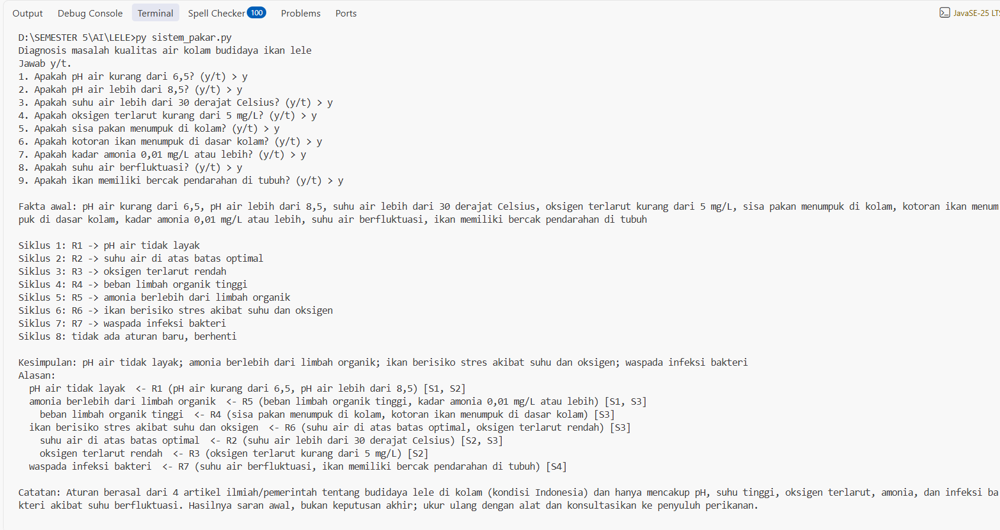
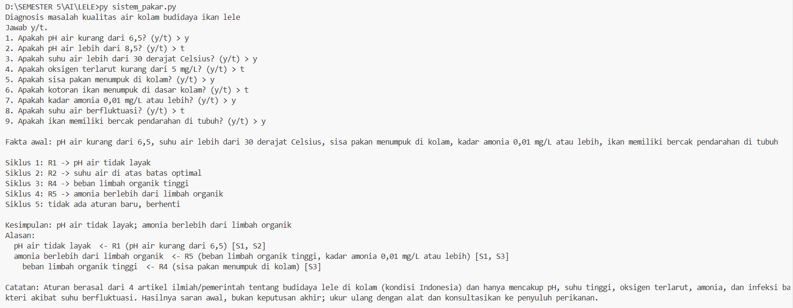
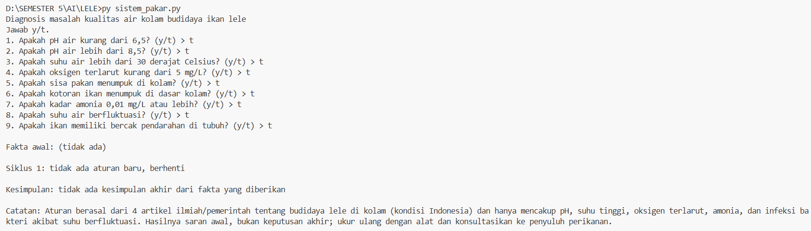

# Tugas 5 Kecerdasan Buatan: Sistem Pakar Kualitas Air Kolam Lele

**Nama:** Sri Zul'aini Ulya

**NIM:** F1D02410096

## 1. Topik dan Cara Menjalankan

Topik: diagnosis masalah kualitas air pada kolam budidaya ikan lele (pH, suhu, oksigen terlarut, amonia, dan infeksi bakteri akibat suhu berfluktuasi). Topik ini bukan kesehatan manusia dan bukan topik yang dilarang.

- Bahasa: Python 3.13 (tanpa pustaka tambahan, hanya modul bawaan `json` dan `argparse`)
- Mode interaktif: `python fc_lele.py`
- Mode otomatis (untuk kasus uji), angka adalah nomor pertanyaan yang dijawab "ya": `python fc_lele.py --ya 3 4 5 7`
- Semua jawaban "tidak": `python fc_lele.py --ya`

Berkas: `kb_lele.json` (basis aturan), `fc_lele.py` (mesin inferensi), folder `screenshot/` (bukti uji).

## 2. Sumber dan Tabel Aturan

| Kode | Sumber (judul, penerbit, URL, tanggal akses) |
|---|---|
| S1 | Studi kesesuaian kualitas air untuk budidaya lele dumbo di Kabupaten Bandung (acuan SNI 01-6484.5:2002), Aurelia Journal, Balitbang KKP, https://ejournal-balitbang.kkp.go.id/index.php/aureliajournal/article/download/9887/7241, diakses 13 Nov 2026 |
| S2 | Efektivitas Bakteri Fotosintetik Rhobac dalam Meningkatkan Kualitas Air pada Budidaya Ikan Lele di Kolam Terpal, STIPER Kutai Timur, https://ojs.stiperkutim.ac.id/index.php/jpt/article/download/610/296, diakses 13 Nov 2026 |
| S3 | Implementasi Teknologi IoT untuk Monitoring Kolam Budidaya Ikan Lele (Desa Karangreja, Banyumas), Telkom University, repositori.telkomuniversity.ac.id (URL lengkap ada di `kb_lele.json`), diakses 13 Nov 2026 |
| S4 | Performansi budidaya pembesaran lele sangkuriang di CV Dampo Awang, Sumedang, Jurnal Balitbang KKP, https://ejournal-balitbang.kkp.go.id/index.php/JSJ/article/download/8445/7400, diakses 13 Nov 2026 |

| Aturan | IF | THEN | Sumber |
|---|---|---|---|
| R1 | pH air kurang dari 6,5 OR pH air lebih dari 8,5 | pH air tidak layak | S1, S2 |
| R2 | suhu air lebih dari 30 derajat Celsius | suhu air di atas batas optimal | S2, S3 |
| R3 | oksigen terlarut kurang dari 5 mg/L | oksigen terlarut rendah | S2 |
| R4 | sisa pakan menumpuk di kolam OR kotoran ikan menumpuk di dasar kolam | beban limbah organik tinggi | S3 |
| R5 | beban limbah organik tinggi AND kadar amonia 0,01 mg/L atau lebih | amonia berlebih dari limbah organik | S1, S3 |
| R6 | suhu air di atas batas optimal AND oksigen terlarut rendah | ikan berisiko stres akibat suhu dan oksigen | S3 |
| R7 | suhu air berfluktuasi AND ikan memiliki bercak pendarahan di tubuh | waspada infeksi bakteri | S4 |

Ada empat kesimpulan akhir (R1, R5, R6, R7). Rantai penalaran: R4 dipakai R5, serta R2 dan R3 dipakai R6.

## 3. Metode: Forward Chaining

Forward chaining dipilih karena pengguna biasanya mengetahui gejala dan hasil pengukuran kolam lebih dulu (pH, suhu, kondisi ikan), lalu ingin tahu masalahnya. Alur ini sesuai dengan arah fakta menuju kesimpulan. Langkahnya:

1. Fakta yang tidak pernah menjadi hasil aturan ditanyakan ke pengguna (y/t); jawaban "ya" masuk ke memori kerja.
2. Cari aturan yang syaratnya terpenuhi oleh memori (mode "dan" = semua syarat ada, mode "atau" = salah satu cukup) dan hasilnya belum ada di memori.
3. Ambil aturan pertama, tambahkan hasilnya ke memori, catat aturan penghasilnya sebagai bahan alasan.
4. Ulangi sampai tidak ada aturan baru. Kesimpulan akhir adalah hasil aturan yang tidak dipakai sebagai syarat aturan lain. Alasan ditampilkan secara rekursif dari kesimpulan menuju fakta awal.

## 4. Kasus Uji

| # | Jawaban "ya" | Kesimpulan | Perintah |
|---|---|---|---|
| 1 | pH air lebih dari 8,5 | pH air tidak layak | `python fc_lele.py --ya 2` |
| 2 | sisa pakan menumpuk di kolam | tidak ada kesimpulan akhir (hanya temuan antara: beban limbah organik tinggi) | `python fc_lele.py --ya 5` |
| 3 | suhu > 30, oksigen < 5, sisa pakan menumpuk, amonia >= 0,01 | amonia berlebih dari limbah organik; ikan berisiko stres akibat suhu dan oksigen | `python fc_lele.py --ya 3 4 5 7` |
| 4 | suhu berfluktuasi, ikan bercak pendarahan | waspada infeksi bakteri | `python fc_lele.py --ya 8 9` |

## 5. Batas Keberlakuan

Pengetahuan dalam sistem ini berasal dari empat artikel ilmiah dan publikasi pemerintah tentang budidaya ikan lele di kolam di Indonesia, sehingga hanya berlaku untuk kolam lele dengan kondisi serupa dan hanya mencakup pH, suhu tinggi, oksigen terlarut, amonia, serta infeksi bakteri akibat suhu berfluktuasi. Masalah lain seperti penyakit parasit, kepadatan tebar, atau mutu pakan tidak tercakup. Hasilnya adalah saran awal, bukan keputusan akhir; pengguna sebaiknya mengukur ulang dengan alat dan berkonsultasi dengan penyuluh perikanan. Catatan yang sama ditampilkan oleh program pada setiap keluaran.

## 6. Penggunaan Alat Bantu AI

Saya menggunakan Claude untuk memahami metode FC dan BC, dan menulis kerangka program serta README.
